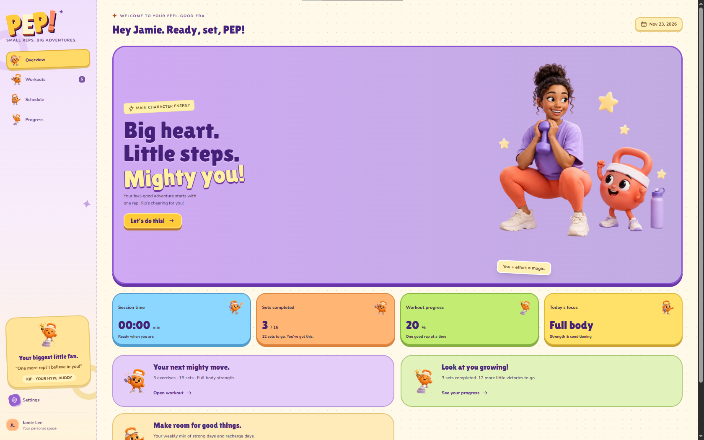

# PEP! — Small reps. Big adventures.

A playful fitness dashboard built around **Kip**, a kettlebell mascot who cheers you through every rep. PEP! turns a strength workout into a friendly, low-pressure experience: count reps, complete sets, track progress, and get encouragement along the way.

> Concept, brand direction and UI by **Haris Mehmood**. First draft generated in Figma Make, then exported and refined by hand.



## Features

- **Overview:** welcome hero, live session stats (time, sets, progress, focus) and quick links into the app
- **Workouts:** five-exercise session with a rep counter, set tracker, form cues from Coach Kip and embedded technique videos
- **Schedule:** weekly mix of strength and recovery days
- **Progress:** per-exercise set breakdown and overall completion
- **Settings:** reset local progress
- **Persistence:** workout progress is saved in the browser with `localStorage` (no account or backend)
- **Accessible details:** keyboard focus states, `aria` labels, live region for rep count, reduced-motion safe animations

## Design

- Chunky, sticker-style cards with solid bottom-edge shadows
- Color-coded stat cards: blue, orange, green and yellow
- A mascot system: Kip appears in the nav, stat cards, section headings and the workout screen, with poses that change by state
- Warm, encouraging microcopy throughout

## Tech stack

- [React](https://react.dev) + TypeScript
- [Vite](https://vitejs.dev)
- [Tailwind CSS](https://tailwindcss.com)
- pnpm

## Getting started

Requires Node.js (LTS) and pnpm.

```bash
git clone https://github.com/Haris-Meh/pep-dashboard.git
cd pep-dashboard
pnpm install
pnpm dev
```

Open the local URL printed in the terminal.

Build for production:

```bash
pnpm build
```

## Project structure

```
src/
  App.tsx          # app shell, views and workout logic
  main.tsx         # React entry point
  index.css        # global styles
public/
  favicon.png
  images/          # Kip poses (kip-pose-0..3.png), kip-poses.png,
                   # kip-transparent.png and hero art (fitness-friends.png)
```

## Roadmap

- [ ] Split `App.tsx` into reusable components (StatCard, SectionHeading, Button)
- [ ] Move colors into design tokens
- [ ] Add motion with Framer Motion
- [ ] Improve the empty state for new users
- [ ] Deploy to Vercel

## Author

**Haris Mehmood** — UI/UX Designer
Portfolio: [harismehmood.framer.website](https://harismehmood.framer.website)
